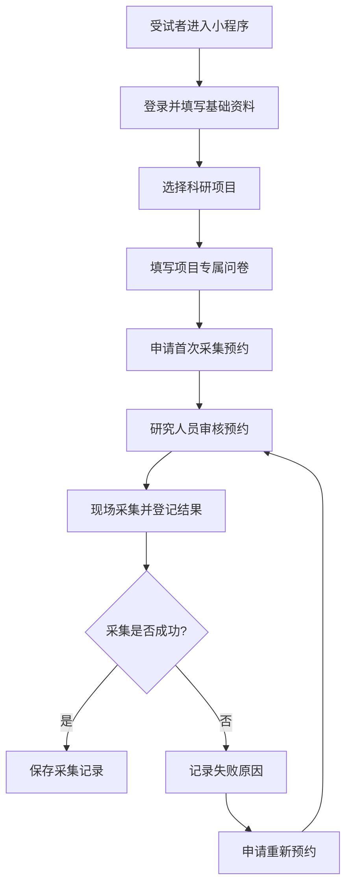
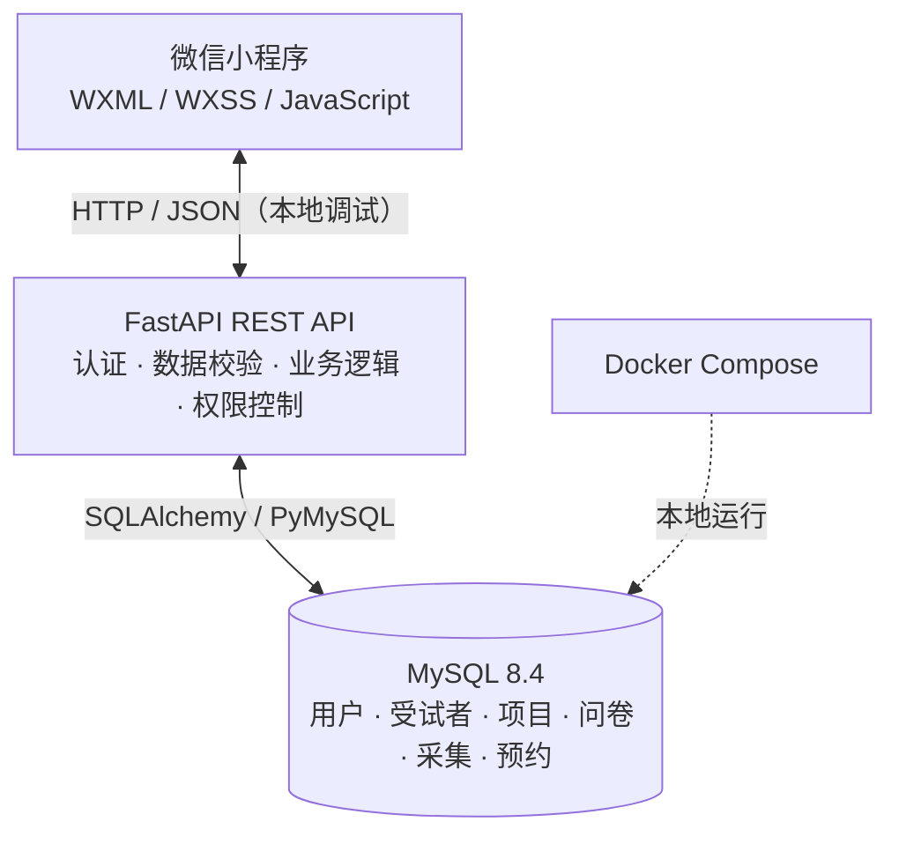

# ResearchHub｜科研受试者信息与采集预约管理平台

> 基于微信小程序、FastAPI 和 MySQL 的科研采集流程管理原型：让受试者信息登记、项目问卷、采集预约和结果管理形成可追溯的闭环。

**当前版本：V0.3 · 本地开发 / 演示阶段**  
**技术栈：** 微信小程序（WXML / WXSS / JavaScript） · Python 3.12 · FastAPI · SQLAlchemy · MySQL 8.4 · Docker Compose

> [!IMPORTANT]
> 当前项目用于开发学习和**虚拟数据演示**，尚未完成正式上线、生产级身份认证、个人信息保护及科研伦理流程。**请勿录入真实受试者身份信息、医疗健康数据或实验原始数据。**

## 项目背景

在医学科研生理信号采集过程中，受试者人口统计学信息往往需要现场手动记录，之后再整理到 Excel；不同项目的补充问卷、采集结果以及失败后的预约也容易分散管理。

ResearchHub 从这一实际需求出发，实现**固定基础资料 + 项目专属问卷**的两层信息登记方式，并关联受试者、科研项目、历次采集和预约申请，以减少重复填写和人工整理。

## 核心功能

| 模块 | 当前实现 |
| --- | --- |
| 受试者登记 | 填写姓名、性别、出生日期、身高、体重；支持基础信息保存与查询、受试者编号生成 |
| 科研项目 | 浏览 CVP、PPG 演示项目及负责人；项目使用各自的表单配置 |
| 项目专属问卷 | 按项目动态显示问卷；PPG 示例支持左右手十个手指部位选择 |
| 首次采集预约 | 受试者填写项目问卷后可提交首次采集预约申请 |
| 采集记录 | 研究人员登记采集次数、实际时间、成功/失败状态、失败原因和数据编号 |
| 失败重约 | 保留失败采集记录，受试者可为失败采集申请重新预约 |
| 预约审核 | 项目研究人员查看预约、确认或拒绝申请；设置允许预约的工作日和时段 |
| 数据导出 | 按项目导出包含受试者、采集记录与预约记录的 Excel 工作簿 |
| 管理权限 | 后端提供项目成员权限校验；本地演示管理员入口仅限开发调试 |

### 典型操作流程



## 系统架构



- **前端：** 页面交互、资料与表单录入、预约和管理工作台。
- **后端：** FastAPI 提供 REST API，校验请求和业务规则，检查项目级访问权限。
- **数据库：** MySQL 保存结构化业务数据；项目问卷配置与答案使用 JSON 字段。
- **开发环境：** Docker Compose 运行本地 MySQL；FastAPI 目前通过本机 Uvicorn 启动。

### 数据设计要点

`users`、`subjects`、`projects`、`enrollments`、`form_responses`、`project_members`、`collections`、`appointments` 是核心业务表。

- **账户与受试者档案分离：** `users` 管理登录身份，`subjects` 保存受试者基础资料。
- **受试者与项目通过 `enrollments` 关联：** 同一受试者可以参与不同科研项目。
- **问卷按项目区分：** 项目表单结构保存在 `projects.form_schema`，答案保存在 `form_responses.answers`。
- **采集与预约分开记录：** 同一项目参与关系下可以形成多条采集、预约历史；失败后不会用新预约覆盖原采集结果。
- **项目级管理：** 通过 `project_members` 约束研究人员可操作的项目范围。

建表参考 `sql/schema.sql`；历史升级脚本位于 `sql/migrate_v0.2_to_v0.3.sql`。

## 项目结构

```text
ResearchHub/
├── backend/
│   ├── app/
│   │   └── main.py               # FastAPI 接口、ORM 模型及业务逻辑
│   ├── .env.example              # 后端配置示例（不应包含真实密码）
│   └── requirements.txt         # Python 依赖
├── miniprogram/
│   ├── pages/                   # 受试者、预约及管理端页面
│   ├── utils/
│   │   ├── api.js               # API 请求封装
│   │   └── config.js            # 开发调试地址与演示开关
│   ├── app.js
│   ├── app.json
│   └── app.wxss
├── sql/
│   ├── schema.sql
│   └── migrate_v0.2_to_v0.3.sql
├── docker-compose.yml          # 本地 MySQL
├── .gitignore
├── README.md
└── CHANGELOG.md               # 版本迭代历史（可单独添加）
```

## 本地运行（Windows PowerShell）

### 1. 环境准备

- Python 3.12、Docker Desktop（处于运行状态）
- 微信开发者工具（用于本地模拟器调试）
- Git（可选，用于克隆和管理版本）

```powershell
git clone https://github.com/rcc125/ResearchHub.git
cd ResearchHub
```

也可以直接下载仓库 ZIP 并解压，进入项目根目录。

### 2. 配置并启动 MySQL

本项目的**公开版** `docker-compose.yml` 应从根目录 `.env` 读取数据库密码，而不是将密码硬编码到可提交文件中。请在根目录新建 `.env`（不要提交 Git），设置：

```dotenv
MYSQL_PASSWORD=replace_with_your_local_mysql_password
MYSQL_ROOT_PASSWORD=replace_with_your_local_root_password
```

如果是新环境，两个密码可设置为不同的强密码；如果是**已有数据库卷**，必须使用数据库当前实际有效的密码，不能只改 `.env` 就认为数据库内的密码已同步修改。

然后执行：

```powershell
docker compose config --quiet
docker compose up -d
docker compose ps
```

期望看到 MySQL 容器处于 `healthy` 状态。**不要执行 `docker compose down -v` 清除数据卷。**

### 3. 创建 Python 环境并安装依赖

```powershell
cd backend
py -3.12 -m venv .venv
.\.venv\Scripts\Activate.ps1
python -m pip install -r requirements.txt
Copy-Item .env.example .env
```

若系统阻止 PowerShell 激活脚本，可在**当前 PowerShell 进程**中执行 `Set-ExecutionPolicy -Scope Process -ExecutionPolicy Bypass` 后重试；也可直接使用 `.venv\Scripts\python.exe` 执行后续命令。

编辑 `backend/.env`，确保 `DATABASE_URL` 与刚才创建的 MySQL 账号及密码一致；将 `JWT_SECRET` 换成自己生成的随机密钥（至少 32 字符）。仅本地虚拟数据测试时可开启 `DEMO_MODE=true`：

```dotenv
DATABASE_URL=mysql+pymysql://researchhub:<your_local_password>@127.0.0.1:3306/researchhub?charset=utf8mb4
JWT_SECRET=<your_random_secret_at_least_32_characters>
WECHAT_APPID=
WECHAT_APPSECRET=
DEMO_MODE=true
```

上面尖括号内容都是**说明性占位符**，必须替换成有效值；如果密码包含 URL 特殊字符，需要进行 URL 编码。实际 `.env` 不应上传 GitHub。

生成随机密钥的命令：

```powershell
python -c "import secrets; print(secrets.token_urlsafe(48))"
```

### 4. 启动 FastAPI

在 `backend` 目录执行：

```powershell
python -m uvicorn app.main:app --host 127.0.0.1 --port 8000 --reload
```

浏览器检查：

- `http://127.0.0.1:8000/health` — 健康检查
- `http://127.0.0.1:8000/docs` — FastAPI 自动生成的接口文档

本地原型启动时由 SQLAlchemy 创建尚不存在的表，并包含有限的 V0.3 增量字段升级逻辑。**现阶段不是通用生产级迁移方案，不要将此方式直接用于正式数据部署。**

### 5. 导入微信开发者工具

1. 打开微信开发者工具，导入项目中的 `miniprogram/` 目录。
2. 开发模拟器联调时，检查 `miniprogram/utils/config.js`：`BASE_URL` 指向 `http://127.0.0.1:8000`，`DEMO_MODE` 设为 `true`。
3. 在开发者工具中启用**仅本地调试所需**的合法域名校验跳过选项，编译小程序。
4. 使用“本地演示登录”进入，测试资料登记、项目问卷、预约及管理员流程。

> **说明：** `127.0.0.1` 指当前运行设备的本机地址，不能直接作为手机真机或线上小程序的后端地址。演示模式登录共用测试身份，仅用于单用户流程演示，不能验证真实用户数据隔离。

## 推荐演示路径

1. 本地演示登录，填写姓名、出生日期、性别、身高和体重，保存后重新读取。
2. 打开 CVP 或 PPG 项目，填写项目专属问卷。
3. 提交首次预约，验证工作日和时间段限制。
4. 在本地演示管理工作台启用**测试用**项目管理员，确认预约并登记采集结果。
5. 模拟一次采集失败，返回受试者端提出重新预约申请，再在管理端审核。
6. 在管理端导出项目 Excel，检查采集时间、记录编号与受试者信息的关联。

**所有演示人物、项目负责人、采集结果均应使用虚构数据。**

## 当前状态与限制

- ✅ 已具备本地小程序前端、FastAPI、MySQL 的基本通信与业务处理代码，并完成过本地演示链路联调。
- ✅ V0.3 代码包括首次预约、失败重约、采集记录、预约审核、项目负责人和工作日配置、Excel 导出。
- ⏳ 尚未正式部署公网服务，未完成真实微信账号下的多受试者生产验证。
- ⏳ 演示管理员入口与演示登录仅供本地测试；正式系统需要受控授权及更完整的身份认证。
- ⏳ 未完成生产级数据保护、审计、备份恢复、科研伦理及正式上线要求；当前不能用于真实受试者信息采集。

## 开发与安全说明

- 不提交 `.env`、访问令牌、数据库备份、真实受试者资料和个人医疗健康信息。
- 请在提交前检查 `docker-compose.yml`、`.env.example` 及 Git 暂存区，避免实际密钥被硬编码。
- 预约时段校验、访问权限与异常处理仍应继续做边界条件测试；当前原型不宣称具备完整并发预约资源锁定能力。
- 如果需要面向真实研究场景使用，须先完善微信小程序正式身份认证、HTTPS / 后端部署、数据访问审计、必要的隐私告知与研究伦理流程。

## 版本历史

详细版本演进见 [CHANGELOG.md](CHANGELOG.md)。

## 项目用途

这是一个围绕科研采集管理实际需求设计的个人开发项目，用于学习微信小程序、Python Web 后端、关系型数据库建模、业务流程设计和前后端联调。
